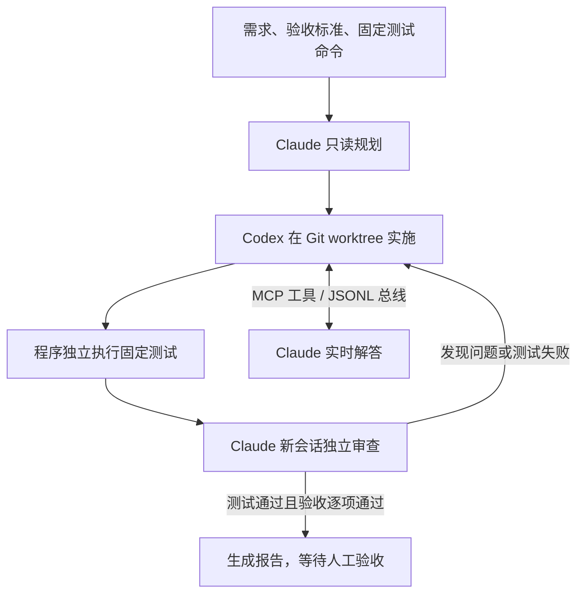

# Codex–Claude Orchestrator

用本地 Python 程序编排 Claude 与 Codex：Claude 规划，Codex 在独立 Git 工作副本实施，程序独立运行固定测试，Claude 再审查；有问题就带着测试日志和审查意见进入下一轮。

当前版本支持 **实施期间实时问答**：Codex 可通过本轮专用的 MCP 消息总线向 Claude 提问，后台 responder 启动只读 Claude 新会话作答。结构化 JSON 负责阶段交接，JSONL 负责实时消息，Markdown 报告用于人工查阅。



## 特性

- 隔离工作副本，保留原项目文件；自动收集完整差异，包括未跟踪的新文件。
- 实施阶段可调用消息总线 `ask`、`send`、`wait`、`history` 工具。
- 固定测试由程序亲自执行，模型的“测试已通过”声明不能覆盖真实退出码。
- Claude 审查必须覆盖全部验收 ID；未知结论、阻塞/重大问题或测试失败不会放行。
- 测试前后与审查前后检查文件指纹，防止把过期测试用于已经变化的代码。
- 保存 `REPORT.md`、`CONVERSATION.md`、JSON 结果、源码差异和原始测试日志。
- 可使用现有 CLI 登录或通过环境变量配置 Claude 的兼容 API 中转服务。

## 环境

核心脚本仅使用 Python 标准库，需要 **Python 3.11+、Git、Codex CLI 和 Claude Code CLI**。CLI 需支持脚本所用的结构化输出及权限参数；`doctor` 会检查必要参数和凭据状态。

本提取版本在 Windows 上验证。核心代码包含 POSIX 进程终止逻辑，但本次没有在 Linux/macOS 上运行测试。`start_claude.ps1` 和下面的 PowerShell 示例用于 Windows。

MPC 示例另需 NumPy、SciPy、Matplotlib，依赖列在其 `requirements.txt` 中。

## 快速开始

在下载后的项目根目录打开终端：

```powershell
# 自测，不调用真实模型
python -m unittest discover -s tests -v

# 演示完整闭环：模拟模型，真实 Git 和测试
python orchestrate.py demo

# 检查 CLI 路径、必要参数及凭据
python orchestrate.py doctor
```

准备真实任务：复制 `task.example.json` 为 `task.json`，填写需求、验收标准和实际测试命令。目标项目须是已有至少一个提交且没有未提交修改的 Git 仓库。

```powershell
Copy-Item task.example.json task.json
python orchestrate.py run --repo "D:\projects\your-project" --task task.json
```

`--repo` 是希望模型修改的目标项目。`--runs-dir` 可指定产物根目录，必须在目标项目之外；默认使用本工具目录下已被忽略的 `runs/`。

测试的 `argv` 是逐项参数数组，工作目录是隔离后的项目根目录。`{python}` 替换为启动本工具的 Python。不要在数组里写 `&&` 或管道；需要脚本时明确指定解释器，例如 `["pwsh", "-NoProfile", "-File", "test.ps1"]`。Windows 的 `.cmd`、`.bat`、`.ps1` 不会被隐式当作原生程序启动。

## 任务参数

| 参数 | 含义 | 默认值 / 范围 |
|---|---|---|
| `title` / `requirement` | 任务名与需求 | 必填 |
| `acceptance` | 含唯一 `id` 和 `description` 的验收项 | 至少一条 |
| `tests` | 含 `name`、`argv`、`timeout_seconds` 的固定测试 | 至少一条 |
| `max_rounds` | 实施、测试、复审的最大轮次 | 3；1–20 |
| `max_questions` | 每轮 Claude 实时作答次数上限 | 5；0–20，0 关闭总线 |
| `agent_timeout_seconds` | 每次模型 CLI 调用的时限 | 1800；1–14400 秒 |

超过实时作答上限的问题会收到记录假设的回退提示，不再启动新的 Claude 作答调用。实时解答只是参考，不改变验收标准和固定测试，也不能直接批准交付。

方案存在待澄清问题时会在实施前停止；工具异常、协议错误和调用超时会保留产物并标记失败；普通测试失败和审查问题会进入下一轮，直到通过或耗尽轮次。

## CLI 与认证

优先发现 PATH 或 `CODEX_CLI_PATH` / `CLAUDE_CLI_PATH` 指定的原生 CLI。Windows 还会尝试发现常见桌面版附带程序。也可复制 `tools.example.json` 为被忽略的 `tools.local.json`，使用可执行文件或程序前缀数组：

```json
{
  "codex": ["codex"],
  "claude": ["claude"]
}
```

可选字段 `codex_model` 和 `claude_model` 指定模型；省略时使用各 CLI 默认值。使用 Node 包时，可以显式填写 `["node", "path/to/cli.js"]`，避免 Windows 批处理二次解析。

Claude 账户登录可运行 `python orchestrate.py login-claude`。使用兼容 API 中转时，在启动本工具的同一终端配置环境变量，例如：

```powershell
$env:ANTHROPIC_BASE_URL = "https://gateway.example.com"
$env:ANTHROPIC_MODEL = "your-provider-model-id"
$relayKey = Read-Host "API Key" -AsSecureString
$env:ANTHROPIC_AUTH_TOKEN = [System.Net.NetworkCredential]::new("", $relayKey).Password
python orchestrate.py doctor
```

中转服务须支持 Claude CLI 所用的 Anthropic Messages 协议、工具调用及结构化响应。若服务要求 `x-api-key`，使用 `ANTHROPIC_API_KEY`，避免同时设置冲突的认证来源。`doctor` 表示凭据被 CLI 识别，不保证服务接受真实请求。实际任务会发送相关代码和日志到所配置服务。

Windows 用户可通过 `start_claude.ps1` 配置并进入独立的 Claude Code 交互界面，详见 [启动说明](CLAUDE_START.md)。独立打开的聊天窗口不会自动加入编排；编排使用自己的 CLI 子进程。

## 放行条件

全部固定测试退出码为 0 且未超时；Claude 返回有效的 `approve`；所有验收项逐项为 `pass`；没有 `blocking` / `major` 问题；交付代码指纹与测试版本一致。`minor` 建议会保留供人工验收。

脚本保留工作副本和差异，由人工确认后再应用、提交或发布。

## 产物与状态

默认目录结构：

```text
runs/<run-id>/
  task.json
  preflight/
  plan/
  worktree/
  round-01/
    implementation/
    bus/messages.jsonl
    questions/
    tests/
    tests.json
    changes.patch
    snapshot.json
    review-packet.json
    review/
  state.json
  events.jsonl
  REPORT.md
  CONVERSATION.md
```

查看某一轮消息总线：

```powershell
python orchestrate.py bus-history --dir "runs/<run-id>/round-01/bus" -n 50
```

退出码 `0` 表示真实任务待验收或演示完成，`2` 表示方案阻塞或轮次耗尽，`1` 表示工具/环境/协议错误，`130` 表示用户中断。请同时检查 `state.json`：真实完成为 `ready_for_acceptance`，演示为 `demo_ready`，并通过 `demo` 字段区分。

## 示例与文档

- [完全背包起始项目](examples/knapsack_demo/README.md)：特意保留待实现函数，用于让编排程序从零完成需求。
- [Python MPC 示例](examples/mpc_demo/README.md)：含约束位置跟踪、测试、仿真及独立 Claude 审查入口。
- [通信与架构](docs/ARCHITECTURE.md)：阶段 JSON、实时 JSONL、MCP 工具和 Markdown 的职责。
- [验证范围](VALIDATION.md)：本发布目录的实际测试与限制。
- [上传说明](docs/PUBLISHING.md)：发布目录、排除规则和上传步骤。
- [提取记录](PUBLICATION_SOURCE.json)：原源码指纹与排除类别。

## 使用范围

当前版本不支持 submodule，不自动复制源项目被忽略的依赖或本机配置，没有自动断点续跑。测试生成物应写入被忽略的临时目录。

文件指纹覆盖 Git 跟踪文件和未被忽略的新文件；这不是对不可信代码的操作系统隔离。工作副本、工具限制与模型审查也不能保证交付无缺陷。完整运行记录可能包含代码、提示词和本机路径，已通过 `.gitignore` 排除在发布文件之外。

接口参考：[Codex 非交互执行](https://learn.chatgpt.com/docs/non-interactive-mode)、[Claude 程序化调用](https://code.claude.com/docs/en/headless)。
