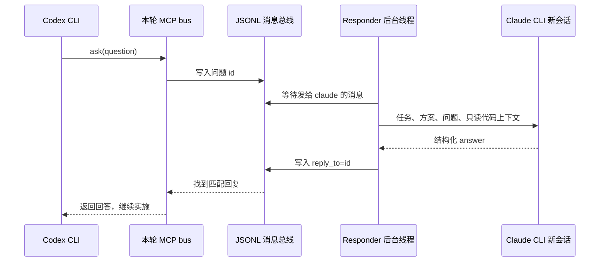

# 通信与架构

## 阶段交接

`Workflow` 负责状态机与放行，`Agents` 封装真实 CLI 子进程。每次调用把指令送到标准输入，并保留提示词、结构协议、标准输出、错误日志及进程结果。

Claude 规划输出 `status / summary / steps / risks / questions`。Codex 实施输出 `summary / changes / tests_run / limitations`。Claude 最终审查输出 `decision / summary / findings / acceptance`，程序按本地严格协议校验，不能通过解析一句自然语言“看起来通过”来放行。

源码位于独立工作副本。程序收集相对于起点提交的完整差异、文件指纹和实际测试结果，再把这些证据的位置传给只读 Claude 审查。阶段间传递的 JSON 与磁盘文件组成交接材料，不要求两个聊天窗口复制消息。

## 实施期间的实时总线

每轮开启实时问答时会创建 `round-NN/bus/`。`Bus` 使用带文件锁的 `messages.jsonl` 保存消息；等待游标按接收方保存在 `cursor-<name>.txt`。历史与游标属于运行产物，不随源码发布。

MCP stdio 服务器由同一个 `orchestrate.py bus-mcp` 启动，暴露 `ask`、`send`、`wait`、`history`；只为本次 Codex 调用增加相应 MCP 配置，不写入用户全局 MCP 设置。

Responder 的上下文是用户任务与 Claude 方案。每个有效问题开启一次 Claude 新会话；它不是永久保持连接的第二个聊天窗口。达到 `max_questions` 后返回回退提示，作答失败也会记录并回复，最终测试与审查门槛保持不变。

## Markdown 的职责

- `REPORT.md` 汇总实施、测试、审查、实时问题与最终状态。
- `CONVERSATION.md` 汇总需求、给模型的指令、规划、问答、测试和审查，便于人工回溯。
- 程序决定是否继续修复主要依靠经过校验的 JSON 与真实测试退出码，Markdown 供人工阅读。

## 权限与边界

Codex 使用 `workspace-write`，Claude 规划、实时作答及审查只提供读取/搜索工具并禁用 MCP。实时回答不能放宽固定验收标准。工作副本和指纹防止常见误操作，但不能替代容器、虚拟机或权限账户对不可信项目的隔离。

本轮总线由编排内部管理。`bus-history` 用于查看已有总线，`bus-mcp` 是内部连接入口；项目没有提供一个可以任意指定两套聊天窗口并永久互聊的独立桌面服务。
